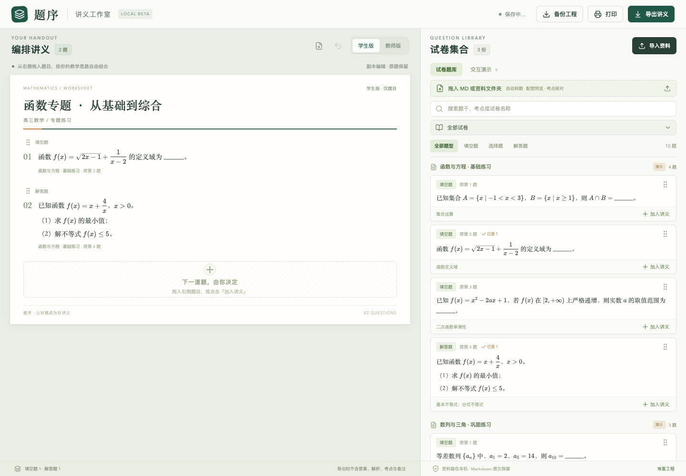
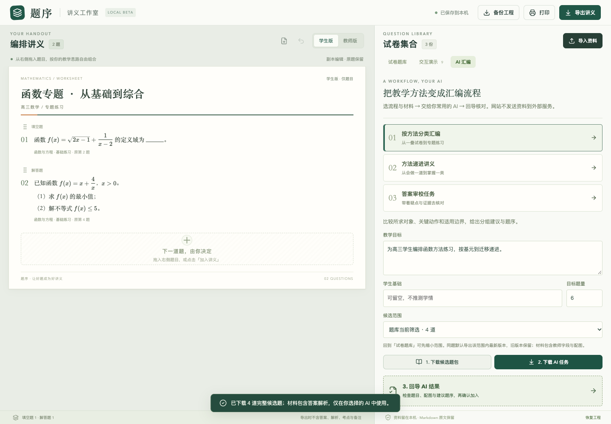

# 题序 · Question Studio

[](https://github.com/cheng-bai/question-studio/actions/workflows/ci.yml)
[](LICENSE)

一个本地运行的数学 Markdown 拖拽组卷编辑器。将资料切分为题目模块，在右侧题库检索，拖入左侧编辑、排序，再输出学生版、教师版和 PDF。

Local-first Markdown question editor for mathematics: import questions and images, compose handouts with drag and drop, render formulas with KaTeX, and print student or teacher editions.



## 当前能力

- MD、MD 与配图、资料文件夹导入；导入前核对题干、答案、解析和考点。
- 默认保守自动拆题；可切换数字加点模式，支持 `1.题干`、`1. 题干`、`1．题干`、跳号与混合题号。
- 拖拽组卷、排序、编辑独立副本、复制、撤销；题库原题不随副本修改。
- 本地 KaTeX 公式渲染；本地配图预览与缺图提示。
- 学生/教师 Markdown，A4 打印及系统保存 PDF。学生版默认填选留白 8 mm、解答留白 30 mm；教师版无额外留白。
- 9 个内置椭圆交互模板，支持独立参数、静态打印与离线课堂 HTML。
- IndexedDB 自动保存当前工作区，JSON 工程备份与恢复。

当前版本为 **0.4.0 原型**。新增模型无关的 AI 汇编任务与标准题包：

- 「AI 汇编」提供方法分类、递进讲义、答案审校任务模板；下载任务说明与完整候选题包，交给你选择的 AI。
- 回导 `*.题包.json`：每题独立 Markdown 字段、题目身份/版本、配图与建议题序，先校验再预览。
- 确认收进题库，可选追加到讲义；同版冲突拒绝覆盖、重复题复用、旧版本保留。候选导出默认取所选范围内每题最新版本。
- 网页与只读 CLI 共用 [题包协议及校验器](docs/题包协议-v0.1.md)。可先在导入题包入口点击「试用 3 道演示题」。



独立文件题库归档、多讲义库、审校补丁、完整 ChangeSet 与 MCP 尚未实现，见[架构草案](docs/AI原生汇编架构草案.md)。网站不调用远程 AI，数学判断由外部 AI 提供建议并由教师核对；本地考点仍为规则建议。

## 快速开始

需要 Node.js 22+ 与 npm：

```bash
git clone https://github.com/cheng-bai/question-studio.git
cd question-studio
npm ci
npm run dev
```

打开 <http://127.0.0.1:5174/>。启动时默认绑定本机地址。

生产构建：

```bash
npm run build
npm run preview
```

已构建后也可使用 Python 3：

```bash
python3 serve.py
```

macOS 可以双击 `启动题序.command`，首次使用仍需先完成 `npm ci && npm run build`。仓库不提交 `dist/` 或 `node_modules/`。

## 使用流程

1. 拖入 MD 与图片，或整个资料文件夹。也可点击「导入资料」。
2. 核对拆题预览；必要时选择「按数字加点」并点「重新拆题预览」。重拆会重置本次预览中的逐题修正与勾选。
3. 确认进入右侧题库，拖到左侧；拖动柄可调序，题目工具栏可编辑、复制、移除与撤销。
4. 在顶部打印入口选择学生/教师版，设置行距、题距、留白与跨页，再打印或通过系统窗口保存 PDF。
5. 下载工程备份以保存题库、讲义、配图和当前设置；备份含教师字段，不作为学生版分发。

一份简易 Markdown：

```markdown
# 函数练习
## 一、填空题
1. 已知 $f(x)=x^2$，求 $f(2)$。
答案：$4$
解析：代入 $x=2$。

2. 已知 $g(x)=x+1$，求 $g(3)$。
答案：$4$
```

也支持标题或粗体题号。大题小问建议使用 `（1）`、`（2）` 或缩进。数字模式会把顶格的数字点解析步骤也当成新题，需核对预览；自动模式保守保留解析中的普通编号。

## 本地资料与边界

- 仓库只含代码、合成演示题和测试夹具，不含维护者的真实试卷、学生材料、配图或工程备份。导入材料的权利由各自持有人保留，不受本项目 MIT 许可证重新授权。
- 默认网页资源、公式字体与资料处理均在本机；浏览器存储依赖地址和浏览器。清除站点数据前先备份。
- 只选一个 MD 文件不会授予网页读取其旁边图片的权限。请同时选择配图、导入完整文件夹，或补充图片；目录结构应与相对引用一致。
- 每批最多 200 份 MD、50 MB；支持 PNG/JPEG/WebP/GIF。远程图片不自动抓取。
- 学生版排除独立答案、解析、考点和教师备注。题干中混写的答案仍需人工核对。
- 拆题与渲染通过不代表数学答案正确。当前没有完整题库索引、云同步、账号或多人协作。
- PDF 通过浏览器系统打印窗口生成；打印预览、字体和整题同页设置会影响分页。

## 开发与验证

```bash
npm test
npm run build
npm run validate:package -- examples/ai-package-demo.题包.json
```

CI 执行模型测试和生产构建。浏览器验收使用独立上下文，需要 Python 3、Google Chrome 以及测试依赖：

```bash
python3 -m pip install playwright Pillow PyMuPDF
python3 tests/browser_smoke.py
python3 tests/import-print-browser.py
python3 tests/print-pagination.py
python3 tests/numbered-density-browser.py
python3 tests/package-browser.py
```

先启动本地网站。分页测试依赖前一步生成的打印 HTML。交互检查另见 `tests/visual-browser.py`、`tests/visual-state.py`、`tests/visual-layout.py`。测试生成的截图、PDF、JSON 和临时夹具被 Git 忽略；不要提交自己的导入资料。

验证记录见 [docs/VALIDATION.md](docs/VALIDATION.md)。

## 持续开发与贡献

[Skill 流程产品化](docs/Skill流程产品化.md)记录了任务模板的教学流程、当前能力与后续方向。

从 [PROJECT_STATE.md](PROJECT_STATE.md) 了解当前状态；开发约定见 [AGENTS.md](AGENTS.md)，贡献说明见 [CONTRIBUTING.md](CONTRIBUTING.md)。AI 原生汇编方案是讨论草案；后续以协议、样例、校验器和可恢复迁移逐步实现。

## 许可

本项目原创部分采用 [MIT](LICENSE)。第三方代码保留各自许可，见 [THIRD_PARTY.md](THIRD_PARTY.md)。
